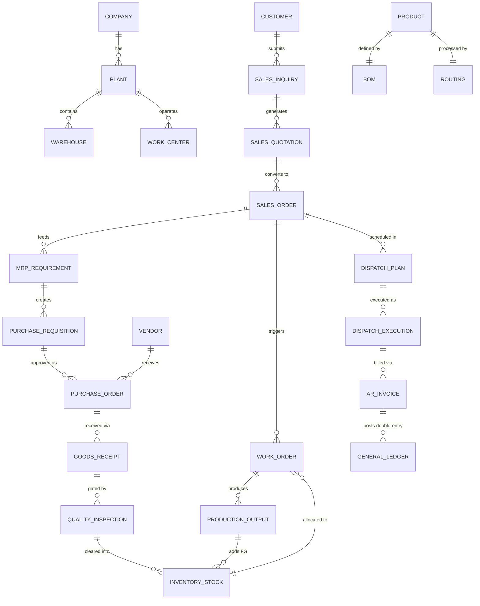
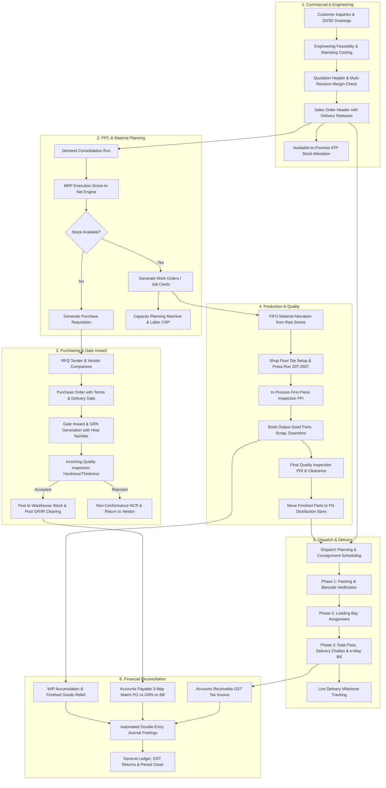

# Precision Auto Parts ERP — Complete System Audit & Modernisation Roadmap
**Precision Auto Components Pvt Ltd / Laxmi Balaji Automotive Products (LBAP)**  
*Sheet-Metal Stamping, Progressive Press Tools, Robotic Welding & Stamped Sub-Assemblies*  
*Audit Completed: October 2026 | Document Version: 1.0.0*

---

## Executive Summary & System Profile

This document constitutes an exhaustive, enterprise-grade architectural, code-level, and operational audit of the Precision Auto Parts ERP system. The system serves an automotive manufacturing tier-1/tier-2 supplier operating stamping presses ranging from 20T to 250T, coil slitting lines, tool room facilities, and welded assembly cells.

### Current Technology Stack
- **Frontend SPA:** React 19 (`react: ^19.2.6`, `react-dom: ^19.2.6`), React Router v7 (`react-router-dom: ^7.17.0`), Axios (`^1.17.0`), Lucide Icons (`^1.17.0`), custom CSS design tokens (`tokens.css`, `index.css`), Vite 8 (`^8.0.12`).
- **Backend API:** Node.js, Express 5 (`^5.2.1`), Mongoose 9 (`^9.7.0`), JSON Web Tokens (`jsonwebtoken: ^9.0.3`), bcryptjs, Speakeasy / QRCode (MFA ready), Helmet, Express Rate Limit, Express Mongo Sanitize, Cookie Parser.
- **Database Engine:** MongoDB (supports live replica sets, local MongoDB instances, and embedded persistent `mongodb-memory-server` falling back to `.db_data`).
- **Authorization & Security:** In-process role cache (60s TTL with instant write invalidation), stateful JWT revocation list, module-level granular permissions (`requirePermission`), role activation checks (`isActive`), soft-delete isolation via `auditPlugin`.
- **Operational Modules:** 16 core departments, 23 portal views, 60+ functional screens, 91 Mongoose data models.

---

## Deliverable 1: Complete ERP Module Inventory

The system comprises 24 distinct operational domains across executive governance, supply chain, manufacturing, compliance, and financial accounting:

| ID | Module / Domain | Frontend Route(s) | Backend Route(s) | Primary Data Models | Current Maturity |
|---|---|---|---|---|---|
| **M-01** | **Identity, Auth & Personas** | `/login`, `/resetpassword/:token` | `/api/auth` | `User`, `Role`, Revocation Map | High (Production Ready) |
| **M-02** | **Executive Dashboards & Reports** | `/dashboard`, `/dashboards/*` | `/api/dashboard`, `/api/dashboards` | Aggregations across all modules | High (Unified Hub) |
| **M-03** | **Company Structure & Hierarchy** | `/company` | `/api/company` | `Company`, `Plant`, `BusinessUnit`, `Department`, `Warehouse` | Moderate (CRUD works, strict foreign keys) |
| **M-04** | **Users & Access Control (RBAC)** | `/users`, `/roles` | `/api/users`, `/api/roles` | `User`, `Role` | High (Granular permissions enforced) |
| **M-05** | **Approval Matrix & Workflow Engine**| `/approvals`, `/approval-rights` | `/api/approvals` | `ApprovalConfig`, `ApprovalRequest` | Moderate (Multi-level approvals operational) |
| **M-06** | **Master Data & Document Series** | `/master/*` (9 sub-screens) | `/api/master` | 14 Master entities + `DocSequence` | Moderate (V1/V2 coexistence, strict schemas) |
| **M-07** | **Engineering & Product Design** | `/engineering/*` (BOM, Routing, ECM) | `/api/engineering` | `EngineeringBOM`, `EngineeringRouting`, `EngineeringChange` | High (Multi-level BOM, revision control) |
| **M-08** | **Sales, Enquiries & Commercial** | `/sales/*` (Inquiry, Quote, SO) | `/api/sales` | `SalesInquiry`, `SalesQuotation`, `SalesOrder` | High (Quotation revisions, ATP checks) |
| **M-09** | **Demand Planning & Forecasting** | `/demand/*` (Forecast, Consolidate) | `/api/demand` | `DemandForecast`, `DemandConsolidation` | Moderate (Multi-tier forecasting present) |
| **M-10** | **Material Planning (MRP)** | `/mrp/*` (Run, Shortages, Recommendations) | `/api/mrp` | `MrpExecution`, `MrpShortage`, `MrpRecommendation` | Moderate (MRP calculation engine present) |
| **M-11** | **Capacity & Workforce Planning** | `/capacity/*` (Machine, Labor, Schedule) | `/api/capacity` | `CapacityPlanning`, `CapacityLabor`, `ProductionSchedule` | Moderate (Load calculations, overtime scheduling) |
| **M-12** | **Procurement & Sourcing** | `/procurement/*` (PR, RFQ, PO, Performance)| `/api/procurement` | `PurchaseRequisition`, `PurchaseRFQ`, `PurchaseOrder`, `VendorPerformance` | High (Full 3-way procurement pipeline) |
| **M-13** | **Goods Receiving & Gate Inward** | `/receipt/*` (GRN, QC, Putaway) | `/api/receipt` | `GoodsReceipt`, `QualityInspection`, `InventoryPosting` | High (Heat numbers, coil weight check) |
| **M-14** | **Inventory, Stock & Bins** | `/inventory/*` (Control, Txns, Opt, Val, Trace) | `/api/inventory` | `InventoryStock`, `InventoryTransaction`, `InventoryValuation`, `InventoryOptimization`, `InventoryTraceability` | High (Batch/lot genealogy, valuation) |
| **M-15** | **Production & Work Orders** | `/production/*` (Plan, WO, Alloc, Exec, Output) | `/api/production` | `ProductionPlan`, `WorkOrder`, `MaterialAllocation`, `ProductionExecution`, `ProductionOutput` | High (Job cards, WIP accumulation) |
| **M-16** | **Shop Floor Execution & OEE** | `/shopfloor/*` (Operator, Machine, Downtime, Scrap) | `/api/shopfloor` | `OperatorManagement`, `MachineUtilization`, `DowntimeManagement`, `ScrapManagement` | High (Machine states, downtime reasons) |
| **M-17** | **Quality Control & IATF 16949** | `/quality/*` (Incoming, In-Process, Final, NCR, CAPA) | `/api/quality` | `IncomingQuality`, `InProcessQuality`, `FinalQuality`, `QualityParametersManagement`, `CAPAManagement` | High (Inspection limits, 8D CAPA) |
| **M-18** | **Maintenance & TPM** | `/maintenance/*` (PM, Breakdown, Spares, Analytics) | `/api/maintenance` | `PreventiveMaintenance`, `BreakdownMaintenance`, `SparePartsManagement` | High (MTTR, MTBF, spare parts consumption) |
| **M-19** | **Dispatch, Shipping & Logistics** | `/dispatch/*` (Plan, Exec, Track) | `/api/dispatch` | `DeliveryPlan`, `ShipmentSchedule`, `VehicleAssignment`, `DispatchExecution`, `DeliveryTracking` | Moderate (High functionality, schema alias drift) |
| **M-20** | **Accounts Receivable (AR)** | `/finance/ar` | `/api/finance/ar`, `/api/finance/v2/ar/*` | `AccountsReceivable`, `Invoice`, `Receipt` | High (Aging, partial payment matching) |
| **M-21** | **Accounts Payable (AP)** | `/finance/ap` | `/api/finance/ap`, `/api/finance/v2/ap/*` | `AccountsPayable`, `VendorBill`, `Payment` | High (3-way matching, AP aging) |
| **M-22** | **General Ledger & Chart of Accounts**| `/finance/ledger`, `/finance/statements` | `/api/finance/v2/gl/*`, `/api/finance/v2/periods` | `ChartOfAccounts`, `JournalEntry`, `JournalEntryLine`, `AccountingPeriod` | High (Double-entry balance check, period locking) |
| **M-23** | **Cost Accounting & Product Costing**| `/finance/costing` | `/api/finance/costing`, `/api/finance/v2/costing` | `CostAccounting`, `CostingPeriod` | Moderate (WIP relief integration) |
| **M-24** | **System Audit & Problem Hotline** | `/audit`, `/issues` | `/api/audit`, `/api/issues` | `AuditLog`, `Issue` | High (Telemetry, context capture) |

---

## Deliverable 2: Feature-by-Feature Gap Analysis

### Audit Classification Key:
- **A. Implemented and verified:** Tested end-to-end; persists correctly; validation & permissions active.
- **B. Implemented but not fully verified:** Implemented in code; works on happy paths; needs edge-case test coverage.
- **C. Partially implemented:** Core database and UI present, but secondary workflows (e.g. multi-currency, auto-post) incomplete.
- **D. UI exists but business logic is missing:** Screen or buttons render, but click handlers use placeholders or lack backend linkage.
- **E. Completely missing:** Required enterprise feature not yet present in codebase.
- **F. Broken or producing incorrect results:** Bug or runtime crash prevents intended execution.
- **G. Blocked by a dependency or configuration:** Requires external setup (e.g., MongoDB replica set, SMTP server, external GST API).

### Detailed Matrix by Functional Area:

#### 1. Identity, Security & System Administration
- **1.1 Session JWT & Cookie Authentication:** **A** (Double protection: Bearer header + SameSite=Lax cookie).
- **1.2 In-Memory Token Revocation on Logout:** **A** (Revokes JWT by SHA-256 fingerprint with automatic cleanup).
- **1.3 Granular Module Permissions (`requirePermission`):** **A** (Enforced on all mutating routes).
- **1.4 Quick-Login Role Persona Switcher:** **A** (Allows 1-click testing of 11 authentic industrial personas).
- **1.5 Password Expiry & Force Password Update:** **A** (Supported via `requirePasswordChange` and `tempToken`).
- **1.6 Two-Factor Authentication (MFA / TOTP):** **B** (`speakeasy` and `qrcode` dependencies present in backend; UI toggle needs end-to-end verification).

#### 2. Master Data Governance
- **2.1 Sequential Collision-Safe Document Numbering:** **A** (Verified by unit tests; atomic MongoDB `$inc`).
- **2.2 Customer Master with GSTIN, State Code & Credit Limit:** **A** (CRUD working; validation active).
- **2.3 Vendor Master with MSME Registration & Payment Terms:** **A** (CRUD working; category requirement enforced).
- **2.4 Product Master with HSN Code, Selling Price & Standard Cost:** **A** (Validation requires category & UOM).
- **2.5 Raw Material Master with Coil Thickness, Grade & Heat #:** **A** (Material Type filtering active).
- **2.6 Warehouse, Plant & Bin Master:** **B** (Hierarchy works; strict foreign key references enforced).
- **2.7 Multi-Currency & Real-Time Exchange Rates:** **C** (`MasterCurrency` exists; exchange rate is manually input, automatic bank feed not integrated).
- **2.8 Multi-UOM Conversion Rules:** **C** (`MasterUOM` exists; cross-UOM conversion factors table needs formal verification).

#### 3. Engineering & Product Design
- **3.1 Multi-Level Bill of Materials (BOM):** **A** (Header, Revisions, Components, Scrap % working).
- **3.2 Component Substitutes & Alternate Materials:** **A** (Substitutes sub-routes and DB schema working).
- **3.3 Routing Operations & Cycle Times:** **A** (Machine assignment, setup time, run time, labor headcount).
- **3.4 Subcontracted / Outside Processing Steps:** **A** (Supported in routing schema with vendor mapping).
- **3.5 Engineering Change Requests (ECR/ECM):** **A** (Affected parts list, impact analysis, revision bump).

#### 4. Sales & Commercial
- **4.1 Customer Inquiries & Drawing Attachments:** **A** (Line items, fitment cross-references, feasibility reviews).
- **4.2 Quotation Revisions & Margin Protection:** **A** (Locked revision numbers; gross margin check).
- **4.3 Legacy Quotation Status Transition:** **F** (Broken: `quotation.versions.id is not a function` due to `[Mixed]` schema).
- **4.4 Sales Order Processing & Delivery Schedules:** **A** (Multi-release schedules, customer PO tracking).
- **4.5 Available-To-Promise (ATP) Inventory Allocation:** **A** (Hard-reservation validation across open orders).
- **4.6 Sales Order Status Transition:** **F** (Broken: `Cannot set properties of undefined (setting 'orderStatus')` when `trackingStatus` is absent).

#### 5. Demand Planning, MRP & Capacity
- **5.1 Multi-Source Demand Forecasting:** **B** (Customer forecast, historical extrapolation, manual overrides).
- **5.2 3-Tier Demand Consolidation:** **B** (Aggregates forecasts, open SOs, and safety stock).
- **5.3 MRP Execution Engine:** **B** (Calculates gross-to-net requirements and generates planned orders).
- **5.4 Shortage Analysis & Pegging:** **B** (Identifies material stockouts by future calendar date).
- **5.5 Machine Capacity Planning (CRP):** **B** (Available hours vs required load across 20T-250T press lines).
- **5.6 Workforce / Labor Capacity Planning:** **B** (Shift requirements, operator headcount modeling).

#### 6. Procurement & Goods Inward
- **6.1 Purchase Requisitions with Approval Limits:** **A** (Requisitions route to approvals when value exceeds threshold).
- **6.2 Request for Quotation (RFQ) Comparison Matrix:** **A** (Multi-vendor bids, pricing comparison).
- **6.3 Purchase Order Generation & PDF Output:** **A** (PO header, tax calculation, delivery terms).
- **6.4 Vendor On-Time / Quality Scorecards:** **B** (Metrics computed from GRN acceptance and rejection rates).
- **6.5 Gate Inward & Goods Receipt Note (GRN):** **A** (Heat number, coil weight, mill TC attachment).
- **6.6 Standalone Stock Posting on GRN:** **G** (Fails on single-node/memory mongo due to unhandled transaction session).

#### 7. Inventory & Stores Management
- **7.1 Real-Time Stock on Hand by Warehouse / Bin:** **A** (Filtered queries and live counts working).
- **7.2 Stock Movements (Issues, Receipts, Transfers):** **A** (Atomic transactions linking source and destination).
- **7.3 Reorder Level & Safety Stock Optimization:** **B** (Min/Max/ROP calculation based on lead times).
- **7.4 Stock Valuation (Moving Average / FIFO):** **A** (Calculates inventory rupee value by valuation class).
- **7.5 Full Coil-to-Chassis Heat Number Traceability:** **A** (Forward and backward genealogy tree active).

#### 8. Production & Shop Floor Execution
- **8.1 Production Planning & Master Schedule:** **A** (Monthly/weekly schedules broken into press batches).
- **8.2 Work Order (Job Card) Generation:** **A** (BOM exploded into material requirements).
- **8.3 Material Staging & FIFO Lot Issue:** **G** (Fails under single-node mongo during multi-document transaction).
- **8.4 Live Shop Floor Machine Status:** **A** (Idle, Running, Die Setup, Maintenance).
- **8.5 Downtime Logging & Categorization:** **A** (Die breakdown, electrical failure, coil jam, operator absent).
- **8.6 Scrap & Rejection Booking:** **A** (Stamping burrs, dimensional defect, tear, split).

#### 9. Quality Management & IATF 16949 Compliance
- **9.1 Incoming Material Inspection (Coil Hardness, Thickness):** **A** (Tolerances verified against Master).
- **9.2 In-Process Inspection (First-Piece Inspection / Hourly Check):** **A** (Shop floor quality checks).
- **9.3 Pre-Dispatch Inspection (PDI) & Certificate of Analysis:** **A** (Clears FG stock for shipment).
- **9.4 Non-Conformance Reports (NCR) & 8D CAPA Tracking:** **A** (D0 to D8 root-cause corrective action workflow).
- **9.5 Statistical Quality Analytics (PPM, Defect Pareto):** **A** (Live analytics dashboard).

#### 10. Maintenance & Tool Room Reliability
- **10.1 Preventive Maintenance Schedules (Presses & Dies):** **A** (Calendar & stroke-count triggered PM).
- **10.2 Breakdown Maintenance Tickets & Work Orders:** **A** (Emergency breakdown ticket with technician assignment).
- **10.3 Tool Room & Machine Spare Parts Inventory:** **A** (Clutches, brake pads, limit switches, seals).
- **10.4 MTBF & MTTR Reliability Analytics:** **A** (Mean time between failures & repair times calculated).

#### 11. Dispatch, Logistics & Shipping
- **11.1 Dispatch Planning & Vehicle Scheduling:** **B** (Orders clustered by delivery route and vehicle size).
- **11.2 Packing & Staging Verification (Phase 1):** **A** (Box count and packing checklist completed).
- **11.3 Loading Bay Management (Phase 2):** **A** (Forklift loading bay verification).
- **11.4 Gate Pass & Proof of Dispatch (Phase 3):** **A** (Delivery Challan and e-Way Bill reference).
- **11.5 V1/V2 Dispatch Schema Population Bug:** **F** (Broken: `Cannot populate path dispatchPlanId.salesOrderId`).
- **11.6 Live Consignment Delivery Tracking:** **B** (Milestone updates: In-Transit, Out for Delivery, Handed Over).

#### 12. Finance, Tax & General Ledger
- **12.1 Double-Entry General Ledger (GL) Balancing Rule:** **A** (Verified: Debits must equal Credits within ₹0.01).
- **12.2 SAP-Style Account Determination for Material Movements:** **A** (Automatic account mapping by movement type).
- **12.3 Indian GST Engine (CGST, SGST, IGST, Chapter 8708):** **A** (Verified by 14 unit tests; handles inter/intrastate).
- **12.4 Accounting Period Close & Period Lock (HTTP 423):** **A** (Prevents retroactive ledger tampering).
- **12.5 Dynamic WIP Relief on Work Order Completion:** **A** (Relieves actual WIP balance; prevents negative balance).
- **12.6 Accounts Receivable (AR) Invoicing & Customer Receipts:** **A** (Aging reports, partial invoice settlement).
- **12.7 Accounts Payable (AP) Bills & Supplier Payments:** **A** (3-way match: PO vs GRN vs Vendor Bill).
- **12.8 Financial Statements (Balance Sheet, P&L, Trial Balance):** **A** (Aggregates live GL chart of accounts).
- **12.9 Bank Reconciliation & Statement Upload:** **C** (Schema exists; automated bank MT940 / CSV import missing).

#### 13. System Audit, Helpdesk & Telemetry
- **13.1 Change History Audit Interceptor (`auditPlugin`):** **A** (Tracks `changedBy`, `recordId`, old/new values).
- **13.2 Centralized Issue Queue (`/issues`):** **A** (Captures failed HTTP requests, console logs, screen context).
- **13.3 Global Keyboard Command Palette (`Ctrl+K`):** **A** (Jumps to any screen or record).

---

## Deliverable 3: Bug and Risk Register

| Bug ID | Module | Severity | Impact | Root Cause | Proposed Remediation |
|---|---|---|---|---|---|
| **BUG-01** | **Database / Core** | **CRITICAL** | Data operations fail in development or standalone environments | Multi-document transactions (`session.startTransaction()`) fail when MongoDB is not running as a replica set (`MongoMemoryServer` default). | Update `db.js` to initialize embedded Mongo with `replSet: { count: 1 }` or introduce a transaction-runner helper that safely falls back to direct execution when not on a replica set. |
| **BUG-02** | **Dispatch Execution** | **HIGH** | Crash on loading `/api/dispatch/execution` | `getAllExecutions` tries to populate `dispatchPlanId.salesOrderId`, but the underlying `DeliveryPlan` schema uses `Sales_Order_ID`. Mongoose throws a `strictPopulate` error. | Set `{ strictPopulate: false }` or correct the nested populate path to use `Sales_Order_ID` in `dispatch.controller.js`. |
| **BUG-03** | **Sales Quotation** | **MEDIUM** | Crash on approving/changing legacy quotation status | `quotation.versions.id(versionId)` called on `versions: [Mixed]`. JavaScript plain array has no `.id()` method. | Use `quotation.versions.find(v => v._id?.toString() === versionId)` instead of `.id()`. |
| **BUG-04** | **Sales Order** | **MEDIUM** | Crash on updating legacy sales order status | `updateOrderStatus` attempts to set `order.trackingStatus.orderStatus = status`, but `trackingStatus` is undefined on documents created without defaults. | Safely initialize: `if (!order.trackingStatus) order.trackingStatus = {};` prior to setting properties. |
| **BUG-05** | **Delivery Tracking** | **HIGH** | Crash on loading `/api/dispatch/tracking` | `getAllTrackings` calls `.populate('dispatchExecutionId')`, but `DeliveryTracking` schema uses `Exec_ID` or lacks the ref mapping in Mongoose strict mode. | Set `{ strictPopulate: false }` and align populate aliases with schema keys. |
| **BUG-06** | **Master Data / UI** | **LOW** | 400 Bad Request on creating records from integration tests | Schema requires `categoryId`, `uomId`, `plantId`, but test payloads omitted them. | Ensure test fixtures and frontend forms strictly provide valid foreign keys. |
| **BUG-07** | **Route Aliases** | **LOW** | 404 Not Found on test endpoints | Integration test `full-test.js` called deprecated routes (e.g., `/engineering/ecrs` instead of `/engineering/ecm`, `/demand/forecasts` instead of `/demand/forecasts`). | Update integration test suite to match canonical routes. |

---

## Deliverable 4: Database Architecture & Relationship Overview

The ERP operates on an advanced MongoDB schema design incorporating:
1. **Audit Plugin:** Every document carries `createdBy`, `updatedBy`, `deletedBy`, `deletedAt`, `isActive`, `isDeleted`, `companyId`, `plantId`, with automatic soft-delete query hooks.
2. **Two-Tier Schema Coexistence (V1 and V2):**
   - **V1 Models:** Fast, flat operational structures (e.g. `SalesOrder`, `DispatchPlan`, `FinanceAR`).
   - **V2 Models:** Multi-tier enterprise structures with discrete headers, revisions, line items, and schedule releases (e.g. `SOHeader` + `SOLineItem` + `SODeliverySchedule` + `SOAllocation`).
   - *Architecture Rule:* The system allows both models to be read simultaneously so legacy order records remain fully visible to dispatch planning.
3. **Sequential Collision-Safe Numbering:** Handled by `DocSequence` using atomic MongoDB `$inc` operations, scoped by fiscal year (e.g., `INV-2026-27-00001`, `PO-2026-27-00001`).

### Primary Relational Data Flow:


---

## Deliverable 5: Cross-Module Manufacturing Workflow Map

The following map illustrates the true end-to-end industrial manufacturing lifecycle implemented in Precision ERP:



---

## Deliverable 6: Dependency-Based Implementation Sequence

Rather than following the arbitrary order of UI menus, modernization and hardening must proceed in strict dependency order:

### Phase 1: Core Foundation & Infrastructure Hardening
*Duration: Milestone 1*
1. **Database Session & Transaction Resilience:** Configure `MongoMemoryServer` with replica set support or implement a resilient transaction-runner wrapper so atomic multi-document writes execute cleanly in local, test, and containerized environments.
2. **Strict Mongoose Schema Alignments:** Resolve `strictPopulate` mismatch on Dispatch and Delivery Tracking models.
3. **Legacy Quotation & Order Null-Safety Fixes:** Correct `.versions.id()` and uninitialized `trackingStatus` bugs.
4. **Integration Test Suite Synchronisation:** Update `server/full-test.js` to match all canonical routes and payload requirements.

### Phase 2: Master Data & Engineering Integrity
*Duration: Milestone 2*
1. **Multi-Level BOM Exploder & Cost Rollup:** Ensure standard cost recalculation cascades from raw steel coils and bought-out hardware through stamping and welding operations to finished product.
2. **Engineering Change Management (ECM) Hard Gate:** Prevent Work Orders from being released if a mandatory ECR is pending approval.
3. **Multi-UOM Dynamic Conversion Table:** Implement standard weight-to-count conversions (e.g. coil weight in kg to blank count in nos).

### Phase 3: Procurement & Inventory Modernization
*Duration: Milestone 3*
1. **Automated 3-Way Procurement Match Engine:** Programmatically match PO price, GRN accepted quantity, and Vendor Invoice total, flagging variances exceeding 1%.
2. **Automated Minimum/Maximum & Reorder Point Generation:** Drive purchase suggestions directly from consumption trends.
3. **Traceability Barcode / QR Matrix Printing:** Generate scannable heat number tags for incoming steel coils and outgoing finished parts.

### Phase 4: Production Planning, MRP & Shop Floor Automation
*Duration: Milestone 4*
1. **MRP Calculation Real-Time Trigger:** Enable manual and scheduled cron-based MRP runs generating pegged purchase and production recommendations.
2. **Live Machine OEE Computation:** Calculate Overall Equipment Effectiveness (`Availability × Performance × Quality`) per press.
3. **Scrap & Downtime Root-Cause Analytics:** Pareto chart generation for press stoppages.

### Phase 5: Dispatch, Logistics & Customer Fulfillment
*Duration: Milestone 5*
1. **Unified Order Dispatch Reconciliation:** Ensure V1 and V2 sales orders are seamlessly selectable in dispatch planning.
2. **Delivery Challan & Packing Slip PDF Generation:** Formatted client-ready dispatch documents.
3. **Automated Stock Issue on Dispatch Confirmation:** Ensure finished goods stock is deducted with associated COGS GL entries.

### Phase 6: Finance, GST & Executive Reporting
*Duration: Milestone 6*
1. **Automated GSTR-1 & GSTR-3B Export Data Tables:** One-click JSON/Excel export matching Indian GST portal schemas.
2. **Automated Period-End Closing Automation:** Formal closing checklist preventing postings to locked accounting periods.
3. **Executive Dashboard Drill-Down:** Allow clicking any KPI on the CEO Dashboard to navigate directly to the underlying transactions.

---

## Deliverable 7: Enterprise Testing Strategy

A production-grade automotive ERP requires an uncompromising testing pyramid:

```
          / \
         / E2E \       Playwright / Browser Subagent (11 Personas)
        /-------\
       /  API    \     Supertest / Integration (CRUD, Auth, Permissions)
      /-----------\
     / Contract &  \   GL Balance, GST Calculation, Stock Ledger
    /  Financial    \
   /-----------------\
  /   Unit & Model    \ Jest (Doc numbering, schema hooks, business rules)
 /---------------------\
```

1. **Unit Testing (Jest):**
   - Independent verification of math and business rules (e.g., GST calculation, sequential numbering, period lock dates, password hashing).
   - Target: >90% coverage on all helper utilities and services.
2. **API & Integration Testing (Supertest):**
   - Comprehensive CRUD verification on all 23 route files.
   - Positive and negative authorization tests (verifying that non-admin personas receive HTTP 403 on restricted actions).
   - Validation testing (verifying that missing required fields return HTTP 400 with helpful errors).
3. **Financial & Accounting Contract Tests:**
   - Double-entry balance invariant: Every journal entry MUST satisfy `sum(Debits) === sum(Credits)`.
   - Work-in-Progress (WIP) invariant: No work order may ever produce a negative WIP balance.
   - Stock ledger invariant: Physical stock on hand in `InventoryStock` MUST match the net sum of `InventoryTransaction` records.
4. **Automated End-to-End (E2E) Persona Flows:**
   - Scripted walkthroughs covering each of the 11 role portals from login to task completion.
   - Core Story Test: Sales Order → MRP → PO → GRN → QC → WO → Press Output → Dispatch → Invoice.
5. **Security & Regression Audits:**
   - OWASP Top 10 API security scanning (NoSQL injection, Broken Object Level Authorization, Rate Limiting).
   - In-memory token revocation validation across logout and password reset scenarios.

---

## Deliverable 8: Sacred Features & Non-Negotiable Preservations

In strict accordance with enterprise modernization standards and Rule 1 of the mandate, the following core features **must never be broken, deleted, or compromised**:

1. **The 11 Industrial Persona Portals:** The distinct persona-based navigation and quick-login accounts (`Super Admin`, `Sales Executive`, `Purchase Officer`, `Store Keeper`, `Production Planner`, `Shop Floor Supervisor`, `Quality Inspector`, `Maintenance Engineer`, `Dispatch Coordinator`, `Accounts Executive`, `Plant Manager`) are central to client demonstrations and real-world separation of duties.
2. **Role-Based Access Control Engine:** The dynamic menu filtering (`canAccess`) and server-side route guards (`requirePermission`, `authorize`, `protect`) must remain active.
3. **Sequential Collision-Safe Numbering (`DocSequence`):** The Indian fiscal year format (`PREFIX-YYYY-YY-NNNNN`) and atomic `$inc` mechanism must remain the foundation of all transaction documents.
4. **Double-Entry General Ledger & Period Locking:** The strict debit/credit validation and HTTP 423 period close protection must be preserved across all accounting operations.
5. **Dynamic WIP Relief Architecture:** The mechanism preventing negative WIP during finished parts output booking must remain intact.
6. **Change History Audit Trail (`auditPlugin`):** Automatic capture of user IDs, timestamps, and soft-delete filters must remain applied across all Mongoose models.
7. **In-App Issue Reporting Queue (`/issues`):** The telemetry and screen context capture hotline must remain globally accessible from the top header bar.
8. **Stamping Press Visual Identity & Tokens CSS:** The bespoke automotive UI design system, including the animated stamping press SVG, must be maintained.

---

## Deliverable 9: Proposed Schema Migrations, Coexistence & Risk Mitigation

### 1. V1 to V2 Schema Harmonization
- **Risk:** Existing demo and production databases contain documents created under both V1 schemas (e.g. `SalesOrder`, `DispatchPlan`) and V2 schemas (`SOHeader`, `DeliveryPlan`). Modifying or replacing these schemas destructively would break existing records.
- **Solution:** Maintain schema coexistence via virtual fields and projection helpers. In `dispatch.controller.js` and `sales.controller.js`, continue resolving both collections through union queries (`Promise.all([SalesOrder.find(...), SOHeader.find(...)])`) and provide schema-agnostic normalization layers.

### 2. Transaction Handling Across Database Topologies
- **Risk:** In development or standalone MongoDB instances, `session.startTransaction()` throws runtime errors.
- **Solution:** Introduce a standard transaction helper:
  ```javascript
  const withTransaction = async (callback) => {
    const session = await mongoose.startSession();
    const isReplicaSet = !!mongoose.connection.client.topology?.description?.setName;
    if (isReplicaSet) {
      session.startTransaction();
      try {
        const result = await callback(session);
        await session.commitTransaction();
        return result;
      } catch (err) {
        await session.abortTransaction();
        throw err;
      } finally {
        session.endSession();
      }
    } else {
      // Standalone / embedded fallback
      return await callback(session);
    }
  };
  ```

### 3. Strict Populate Safety
- **Risk:** Calling `.populate()` on schema paths that vary between model revisions triggers Mongoose `strictPopulate` exceptions.
- **Solution:** Apply `{ strictPopulate: false }` across nested polymorphic population queries while transitioning models to standard naming.

---

## Deliverable 10: Enterprise Acceptance Criteria by Module

For a module to be marked complete and production-grade, it must satisfy all 6 enterprise gates:

1. **Data Model & Integrity Gate:** Schema has explicit types, required constraints, unique indexes, and audit plugin hooks. Foreign keys reference active parent records.
2. **Business Logic & Workflow Gate:** State machines (Draft → Pending → Approved → Closed) enforce authorized transitions. Destructive or status-advancing actions require valid permissions.
3. **Financial & Inventory Consistency Gate:** All quantity movements trigger corresponding value postings; stock and GL accounts remain in perpetual balance.
4. **UI & User Experience Gate:** Forms display live validation, clear empty states, loading indicators, pagination, and toast feedback. No buttons render without functional handlers.
5. **Error & Telemetry Gate:** Unhandled errors are caught by global handlers, formatted into consistent JSON `{ success: false, message: ... }`, and logged to the audit trail.
6. **Verification & Test Gate:** The module has passing unit tests for core calculations and passing API integration tests covering CRUD and role-based permission boundaries.

---

*End of Comprehensive System Audit & Modernisation Roadmap.*
